<!-- Генерат: node .agents/tools/status-model.mjs apps/postrade/deals-app/data/deal-status-model.js — руками не править. -->

# Статусная модель сделки ДИД

Источник — `deal-status-model.js` (`window.DEAL_STATUS_MODEL`). Правка — в нём, затем
`node .agents/tools/status-model.mjs apps/postrade/deals-app/data/deal-status-model.js`.
Сверка значений — с `mock-deals.js` (`window.MOCK_DEALS`).

Дорожек: 4 · статусов: 37 · переходов: 53 · несостыковок: 17 · открытых вопросов: 28.

## Как работает

### Дорожки

У сделки четыре статуса сразу — по дорожке на каждого участника процесса: общий статус сделки (поле status), ЦУП (statusTsup), Operations (statusOps) и Мониторинг (statusMon). Дорожки — вкладки тайла «Заведение сделки» (Navigator); на каждой — степпер и кнопки переходов из текущего статуса. Чипы шапки сделки и реестра портфеля показывают те же значения. Сплошная стрелка — ручной переход (кнопка подвала тайла или пункт кебаба), пунктир — автоматический: он срабатывает после переходов других дорожек.

### Первый цикл

Новая сделка — «Черновик» на всех дорожках, кроме мониторинга («На утверждении»). Сущности правятся. Когда нажат шаг «Согласование» степпера, включается «Передать на сопровождение»: сделка уходит в «Ожидает подтверждения», ЦУП — в «Ожидает назначения ответственного», Operations — в «Ожидает подтверждения». ЦУП назначает ответственного (окно назначения), затем утверждает; Operations подтверждает. Подтверждение одного меняет только его статус. Когда ЦУП утвердил и Operations подтвердил, сделка автоматически становится «Активной», а мониторинг — «Утверждена».

### Корректировка

ЦУП или Operations могут вернуть сделку «На корректировку»: сделка автоматически переходит в «Корректировку», сущности снова правятся. Исправленную сделку снова передают на сопровождение той же кнопкой — допущение, в требованиях «вновь отправить на подтверждение». Меняется ли статус второй команды, когда возвращает одна, — вопрос 23. На схеме макета у дорожки «Сделка» «Корректировки» нет — вопрос 2.

### Цикл изменений

«Ввести изменения» в кебабе «Активной» сделки открывает окно причины и переводит сделку в «Ввод изменений»; ЦУП и Operations переходят туда же автоматически. После правок снова нажимают «Согласование» и передают на сопровождение — «Подтверждение изменений». Дальше как в первом цикле, но без назначения ответственного. Когда ЦУП и Operations приняли изменения, сделка снова «Активная» (допущение: автоматически, на схеме линия сплошная — вопрос 10); вернуть изменения можно «На корректировку» — «Корректировка изменений».

### Мониторинг

После утверждения ЦУП мониторинг — «Утверждена». Сотрудник ЦУП отправляет сделку на мониторинг: «На мониторинг (ПАО Сбербанк)» ставит её на мониторинг сразу; «На мониторинг (ГК СБИ)» ведёт в «Ожидает передачи на мониторинг», затем «Направить на передачу» с датой. В «Передана» три подразделения — РМ, ПМ и ПМЗ — подтверждают приём (окно подтверждения); это отметки внутри статуса, а не статусы (допущение, вопрос 9). Когда приняли все трое — «На мониторинге ГК СБИ». Как сделка попадает из «Направлена на передачу» в «Передана», макеты не показывают — вопрос 19. Изменения на мониторинг передаются пунктом кебаба тем же путём (вопрос 7).

### Погашение и возврат

«Погасить» в кебабе «Активной» сделки открывает окно с датой погашения; дата встаёт в карточку «Сроки сделки». Сделка — «Погашена», остальные дорожки гасятся автоматически. Погашение обратимо: «Вернуть в действующие» возвращает сделку в «Активную», инструменты остаются погашенными (вопросы 1 и 24).

### Удаление

Черновик можно удалить пунктом кебаба. Удалённой сделки нет в портфеле, статусы трёх других ролей не отображаются, восстановить её нельзя. Статуса «Удалена» нет в требованиях и данных — вопрос 12.

## Схема

Сплошная стрелка — ручной переход, пунктир — автоматический, толстая — тип не указан.
Узлы: толстая рамка — начальный, зелёный — целевой, фиолетовый — конечный, красный —
терминальный, серый — промежуточный, пунктирная рамка — статуса нет на схеме макета.
Петля — действие без смены статуса.

```mermaid
flowchart LR
  subgraph deal["Сделка"]
    direction TB
    deal_draft["Черновик"]:::initial
    deal_deleted["Удалена"]:::terminal
    deal_awaiting["Ожидает подтверждения"]:::intermediate
    deal_correction["Корректировка"]:::offschema
    deal_active["Активная"]:::final
    deal_repaid["Погашена"]:::terminal
    deal_changes_input["Ввод изменений"]:::intermediate
    deal_changes_confirm["Подтверждение изменений"]:::intermediate
    deal_changes_correction["Корректировка изменений"]:::offschema
  end
  subgraph tsup["ЦУП"]
    direction TB
    tsup_draft["Черновик"]:::initial
    tsup_awaiting_responsible["Ожидает назначения ответственного"]:::intermediate
    tsup_awaiting["Ожидает подтверждения"]:::intermediate
    tsup_correction["Корректировка"]:::intermediate
    tsup_approved["Утверждена"]:::target
    tsup_changes_input["Ввод изменений"]:::intermediate
    tsup_changes_confirm["Подтверждение изменений"]:::intermediate
    tsup_changes_correction["Корректировка изменений"]:::intermediate
    tsup_repaid["Погашена"]:::offschema
  end
  subgraph ops["Operations"]
    direction TB
    ops_draft["Черновик"]:::initial
    ops_awaiting["Ожидает подтверждения"]:::intermediate
    ops_correction["Корректировка"]:::intermediate
    ops_on_support["На сопровождении"]:::target
    ops_changes_input["Ввод изменений"]:::intermediate
    ops_changes_confirm["Подтверждение изменений"]:::intermediate
    ops_changes_correction["Корректировка изменений"]:::intermediate
    ops_repaid["Погашена"]:::offschema
  end
  subgraph mon["Мониторинг"]
    direction TB
    mon_on_approval["На утверждении"]:::initial
    mon_approved["Утверждена"]:::intermediate
    mon_awaiting_transfer["Ожидает передачи на мониторинг"]:::intermediate
    mon_sent_to_transfer["Направлена на передачу"]:::intermediate
    mon_transferred["Передана"]:::intermediate
    mon_on_mon_sbi["На мониторинге ГК СБИ"]:::final
    mon_on_mon_pao["На мониторинге ПАО Сбербанк"]:::final
    mon_changes_awaiting["Изменения ожидают передачи на мониторинг"]:::offschema
    mon_changes_sent["Изменения направлены на передачу"]:::offschema
    mon_changes_transfer["Передача изменений"]:::intermediate
    mon_repaid["Погашена"]:::intermediate
  end
  deal_draft -->|"Удалить"| deal_deleted
  deal_draft -->|"Передать на сопровождение"| deal_awaiting
  deal_awaiting -.->|"ЦУП или Operations вернули на корректировку"| deal_correction
  deal_correction -->|"Передать на сопровождение"| deal_awaiting
  deal_awaiting -.->|"ЦУП утвердил и Operations подтвердил"| deal_active
  deal_active -->|"Погасить"| deal_repaid
  deal_repaid -->|"Вернуть в действующие"| deal_active
  deal_active -->|"Ввести изменения"| deal_changes_input
  deal_changes_input -->|"Передать на сопровождение"| deal_changes_confirm
  deal_changes_confirm -.->|"ЦУП или Operations вернули изменения на корректировку"| deal_changes_correction
  deal_changes_correction -->|"Передать на сопровождение"| deal_changes_confirm
  deal_changes_confirm -.->|"ЦУП и Operations приняли изменения"| deal_active
  tsup_draft -.->|"сделку передали на сопровождение"| tsup_awaiting_responsible
  tsup_awaiting_responsible -->|"Назначить ответственного"| tsup_awaiting
  tsup_awaiting -->|"Утвердить"| tsup_approved
  tsup_awaiting -->|"На корректировку"| tsup_correction
  tsup_correction -.->|"исправленную сделку снова передали на сопровождение"| tsup_awaiting
  tsup_approved -.->|"по сделке начат ввод изменений"| tsup_changes_input
  tsup_changes_input -.->|"изменения передали на сопровождение"| tsup_changes_confirm
  tsup_changes_confirm -->|"Утвердить"| tsup_approved
  tsup_changes_confirm -->|"На корректировку"| tsup_changes_correction
  tsup_changes_correction -.->|"исправленные изменения снова передали на сопровождение"| tsup_changes_confirm
  tsup_approved -.->|"сделку погасили"| tsup_repaid
  ops_draft -.->|"сделку передали на сопровождение"| ops_awaiting
  ops_awaiting -->|"Подтвердить"| ops_on_support
  ops_awaiting -->|"На корректировку"| ops_correction
  ops_correction -.->|"исправленную сделку снова передали на сопровождение"| ops_awaiting
  ops_on_support -.->|"по сделке начат ввод изменений"| ops_changes_input
  ops_changes_input -.->|"изменения передали на сопровождение"| ops_changes_confirm
  ops_changes_confirm -->|"Подтвердить"| ops_on_support
  ops_changes_confirm -->|"На корректировку"| ops_changes_correction
  ops_changes_correction -.->|"исправленные изменения снова передали на сопровождение"| ops_changes_confirm
  ops_on_support -.->|"сделку погасили"| ops_repaid
  mon_on_approval -.->|"ЦУП утвердил сделку"| mon_approved
  mon_approved -->|"На мониторинг (ГК СБИ)"| mon_awaiting_transfer
  mon_approved -->|"На мониторинг (ПАО Сбербанк)"| mon_on_mon_pao
  mon_awaiting_transfer --> mon_on_mon_pao
  mon_on_mon_pao -->|"На мониторинг (ГК СБИ)"| mon_awaiting_transfer
  mon_awaiting_transfer -->|"Направить на передачу"| mon_sent_to_transfer
  mon_sent_to_transfer ==>|"?"| mon_transferred
  mon_transferred -->|"РМ принял"| mon_transferred
  mon_transferred -->|"ПМ принял"| mon_transferred
  mon_transferred -->|"ПМЗ принял"| mon_transferred
  mon_transferred -.->|"РМ, ПМ и ПМЗ приняли"| mon_on_mon_sbi
  mon_on_mon_sbi -->|"Передать изменения на мониторинг"| mon_changes_awaiting
  mon_changes_awaiting -->|"Направить на передачу"| mon_changes_sent
  mon_changes_sent ==>|"?"| mon_changes_transfer
  mon_changes_transfer -->|"РМ принял"| mon_changes_transfer
  mon_changes_transfer -->|"ПМ принял"| mon_changes_transfer
  mon_changes_transfer -->|"ПМЗ принял"| mon_changes_transfer
  mon_changes_transfer -.->|"РМ, ПМ и ПМЗ приняли изменения"| mon_on_mon_sbi
  mon_on_mon_sbi -.->|"сделку погасили"| mon_repaid
  mon_on_mon_pao -.->|"сделку погасили"| mon_repaid
  classDef initial fill:#E8EDED,stroke:#283237,stroke-width:3px,color:#131618
  classDef intermediate fill:#E8EDED,stroke:#283237,color:#131618
  classDef target fill:#E8F5E9,stroke:#4CAF50,color:#2E7D32
  classDef final fill:#EDE7F6,stroke:#7E57C2,color:#311B92
  classDef terminal fill:#FEEBEE,stroke:#EF5350,color:#C62828
  classDef offschema fill:#FBFBFB,stroke:#A0A8B0,stroke-dasharray:4 3,color:#131618
```

## Статусы

### Сделка — поле `status`, словарь тонов `general`

| Статус | id | Вид | Тон | Правка сущностей | Записей | Пояснение | Вопросы |
|---|---|---|---|---|---|---|---|
| Черновик | `deal_draft` | начальный | `chip--dark` | да | 5 | Все новые сделки создаются с этим статусом. Минимум для передачи на сопровождение: дата заключения и один из инструментов (акция, транш…); остальные карточки можно оставить пустыми. Кнопка «Передать на сопровождение» неактивна, пока не нажат шаг «Согласование» степпера. | — |
| Удалена | `deal_deleted` | терминальный | — | — | 0 | Статусы трёх других ролей не отображаются. Удалённой сделки нет в «Текущем портфеле ДИД», открыть её можно только по прямой ссылке. Восстановить нельзя — только завести новую с теми же данными. | 12 |
| Ожидает подтверждения | `deal_awaiting` | промежуточный | `chip--warning` | нет | 8 | ЦУП и Operations проверяют данные: ЦУП — контрагентов, даты, корпдоговоры и обеспечение; Operations — продукты и инструменты, даты покупки и продажи, суммы, комиссии. Каждый принимает сделку или отправляет на корректировку; подтверждение одного меняет только его статус. Подвал тайла — строка статуса, кнопок нет. | — |
| Корректировка | `deal_correction` | нет на схеме | `chip--info` | да | 4 | Сделка не прошла утверждение и возвращена на корректировку (требования). На схеме у дорожки «Сделка» этого статуса нет. | 2, 3 |
| Активная | `deal_active` | конечный | `chip--success` | нет | 22 | Обе команды (ЦУП и Operations) утвердили сделку. Дальше — погасить или ввести изменения, проходя цикл утверждения заново. Сущности не правятся. | 13 |
| Погашена | `deal_repaid` | терминальный | `chip--dpurple` | нет | 3 | Гасится из кебаба навигатора с датой погашения; дата встаёт в карточку «Сроки сделки». Все инструменты и все статусы сделки тоже погашаются. Погашение обратимо: сделку можно вернуть в действующие, инструменты останутся погашенными. | 1, 14 |
| Ввод изменений | `deal_changes_input` | промежуточный | `chip--info` | да | 3 | Изменения вносятся через кебаб навигатора; сущности снова правятся. Изменение может влиять на финметрики (пришёл платёж, пересчитаны проценты) или не влиять (команда, описание). В подвале — «Список изменений» и «Передать на сопровождение». | — |
| Подтверждение изменений | `deal_changes_confirm` | промежуточный | `chip--warning` | нет | 3 | После ввода изменений снова нажимают шаг «Согласование» и передают на сопровождение. Дальше как в первом цикле, но без назначения ответственного от ЦУП. | — |
| Корректировка изменений | `deal_changes_correction` | нет на схеме | `chip--info` | да | 2 | Изменения не прошли подтверждение и возвращены на корректировку (требования). На схеме у дорожки «Сделка» этого статуса нет. | 2 |

### ЦУП — поле `statusTsup`, аватарка «Ц», словарь тонов `general`

| Статус | id | Вид | Тон | Правка сущностей | Записей | Пояснение | Вопросы |
|---|---|---|---|---|---|---|---|
| Черновик | `tsup_draft` | начальный | `chip--dark` | — | 5 | Пока сделку не передали на согласование. | — |
| Ожидает назначения ответственного | `tsup_awaiting_responsible` | промежуточный | `chip--warning` | — | 2 | Директор ЦУП или сотрудник ЦУП выбирает ответственного за сделку; выбранный сотрудник попадает в команду сделки. В окне — ГСЗ из описания сделки, сделки этой ГСЗ и их ответственные. | — |
| Ожидает подтверждения | `tsup_awaiting` | промежуточный | `chip--warning` | — | 6 | ЦУП проверяет контрагентов, даты, корпдоговоры и обеспечение; утверждает или возвращает на корректировку. | — |
| Корректировка | `tsup_correction` | промежуточный | `chip--info` | — | 4 | ЦУП или Operations вернули сделку: данные исправляют и снова отправляют на подтверждение. | 3, 23 |
| Утверждена | `tsup_approved` | целевой | `chip--success` | — | 22 | Сотрудник ЦУП утвердил сделку или корректировку. | — |
| Ввод изменений | `tsup_changes_input` | промежуточный | `chip--info` | — | 3 | Сотрудник ЦУП или иной сотрудник вводит изменения. | — |
| Подтверждение изменений | `tsup_changes_confirm` | промежуточный | `chip--warning` | — | 3 | ЦУП проверяет изменения: принимает или отправляет на корректировку. | 11, 18 |
| Корректировка изменений | `tsup_changes_correction` | промежуточный | `chip--info` | — | 2 | На схеме узел подписан «Корректировка». | 4 |
| Погашена | `tsup_repaid` | нет на схеме | `chip--dpurple` | — | 3 | Как у сделки: если сделка гасится, она гасится для всех. | 14 |

### Operations — поле `statusOps`, аватарка «O», словарь тонов `general`

| Статус | id | Вид | Тон | Правка сущностей | Записей | Пояснение | Вопросы |
|---|---|---|---|---|---|---|---|
| Черновик | `ops_draft` | начальный | `chip--dark` | — | 5 | Пока сделку не передали на согласование. | — |
| Ожидает подтверждения | `ops_awaiting` | промежуточный | `chip--warning` | — | 8 | Operations проверяет продукты и инструменты, даты покупки и продажи, суммы, комиссии; подтверждает или возвращает на корректировку. | — |
| Корректировка | `ops_correction` | промежуточный | `chip--info` | — | 4 | ЦУП или Operations вернули сделку: данные исправляют и снова отправляют на согласование (сопровождение). | 3, 23 |
| На сопровождении | `ops_on_support` | целевой | `chip--success` | — | 22 | Сотрудник Operations всё проверил и принял сделку. | — |
| Ввод изменений | `ops_changes_input` | промежуточный | `chip--info` | — | 3 | Сделка переведена в ввод изменений. | — |
| Подтверждение изменений | `ops_changes_confirm` | промежуточный | `chip--warning` | — | 3 | Неверные изменения ЦУП или Operations возвращают на корректировку изменений. | — |
| Корректировка изменений | `ops_changes_correction` | промежуточный | `chip--info` | — | 2 | На схеме узел подписан «Корректировка». | 4 |
| Погашена | `ops_repaid` | нет на схеме | `chip--dpurple` | — | 3 | Как у сделки: если сделка гасится, она гасится для всех. | 14 |

### Мониторинг — поле `statusMon`, аватарка «М», словарь тонов `mon`

| Статус | id | Вид | Тон | Правка сущностей | Записей | Пояснение | Вопросы |
|---|---|---|---|---|---|---|---|
| На утверждении | `mon_on_approval` | начальный | `chip--dark` | — | 17 | Первый статус вкладки мониторинга у только что созданной сделки (требования). На схеме его нет. | 5 |
| Утверждена | `mon_approved` | промежуточный | `chip--dark` | — | 0 | Первый статус вкладки мониторинга, ставится автоматически после утверждения ЦУП (screenflow). На мониторинг отправляет сотрудник ЦУП: ГК СБИ — если есть кредиты, акции, опционы с баланса ГК СБИ; ПАО Сбербанк — если их нет, а есть корпдоговор и НКЛ с баланса ПАО. | 5, 16 |
| Ожидает передачи на мониторинг | `mon_awaiting_transfer` | промежуточный | `chip--warning` | — | 2 | Промежуточный статус после «На мониторинг (ГК СБИ)». Когда документы готовы, сделку направляют на передачу с датой. | — |
| Направлена на передачу | `mon_sent_to_transfer` | промежуточный | `chip--warning` | — | 1 | Три подразделения (ПМ, РМ, ПМЗ) подтверждают, что всё проверили и приняли сделку; кнопки нажимает сотрудник ЦУП. На схеме узел подписан «Направлено на передачу». | 17, 19 |
| Передана | `mon_transferred` | промежуточный | `chip--warning` | — | 1 | На схеме узел «Передача»; в этом статусе тайл показывает кнопки «РМ принял», «ПМ принял», «ПМЗ принял». | 6, 9, 19 |
| На мониторинге ГК СБИ | `mon_on_mon_sbi` | конечный | `chip--success` | — | 12 | После принятия всеми тремя подразделениями сделка встаёт на мониторинг. Дальше можно передавать изменения на мониторинг. | 8 |
| На мониторинге ПАО Сбербанк | `mon_on_mon_pao` | конечный | `chip--success` | — | 11 | Кнопка «На мониторинг (ПАО Сбербанк)» ставит на мониторинг сразу, без дополнительных шагов. Есть технический переход с ПАО на передачу в ГК СБИ и обратно. | 8, 25 |
| Изменения ожидают передачи на мониторинг | `mon_changes_awaiting` | нет на схеме | `chip--warning` | — | 1 | Пункт кебаба «Передать изменения на мониторинг». На схеме цикл изменений — один узел «Передача изменений на мониторинг». | 7 |
| Изменения направлены на передачу | `mon_changes_sent` | нет на схеме | `chip--warning` | — | 1 | Дальше те же шаги, что при первой передаче на мониторинг. | 7, 19 |
| Передача изменений | `mon_changes_transfer` | промежуточный | `chip--warning` | — | 1 | На screenflow узел «Передача изменений на мониторинг», на схеме «Статусы сделки» цикла изменений мониторинга нет; в этом статусе тайл показывает кнопки «РМ принял», «ПМ принял», «ПМЗ принял». | 7, 20 |
| Погашена | `mon_repaid` | промежуточный | `chip--dpurple` | — | 3 | После погашения в навигаторе соответствующий статус. На screenflow узел «Погашение», серый (промежуточный); на схеме «Статусы сделки» его нет. | 8, 14 |

## Переходы

### Сделка

| id | Откуда → куда | Тип | Кто | Как | Действие | Окно | Условие | Примечание | Вопросы |
|---|---|---|---|---|---|---|---|---|---|
| `deal_delete` | Черновик → Удалена | ручной | — | меню | Удалить | — | — | Подпись пункта меню — из задачи RE0013 (§4), на макетах её нет. | 12 |
| `deal_submit` | Черновик → Ожидает подтверждения | ручной | — | кнопка | Передать на сопровождение | — | нажат шаг «Согласование» степпера | — | — |
| `deal_return_to_correction` | Ожидает подтверждения → Корректировка | авто | — | — | — | — | ЦУП или Operations вернули на корректировку; после: tsup_to_correction, ops_to_correction | По требованиям; на схеме перехода нет. | 2, 3, 23 |
| `deal_resubmit` | Корректировка → Ожидает подтверждения | ручной | — | кнопка | Передать на сопровождение | — | нажат шаг «Согласование» степпера | Допущение: та же кнопка, что у черновика; в требованиях — «вновь отправить на подтверждение». | 2 |
| `deal_activate` | Ожидает подтверждения → Активная | авто | — | — | — | — | ЦУП утвердил и Operations подтвердил; после: tsup_approve, ops_confirm; и статусы: tsup_approved, ops_on_support | — | — |
| `deal_repay` | Активная → Погашена | ручной | — | меню | Погасить | `NavigatorDealCloseModal` | указана дата погашения | — | 14 |
| `deal_unrepay` | Погашена → Активная | ручной | — | меню | Вернуть в действующие | — | — | По пояснению «погашение обратимо»; на схеме перехода нет. Подпись пункта — из задачи RE0013 (§4). | 1, 24 |
| `deal_start_changes` | Активная → Ввод изменений | ручной | — | меню | Ввести изменения | `NavigatorChangeReasonModal` | — | Окно причины — пара фронтенда; на макетах окна нет. | — |
| `deal_submit_changes` | Ввод изменений → Подтверждение изменений | ручной | — | кнопка | Передать на сопровождение | — | нажат шаг «Согласование» степпера | — | — |
| `deal_changes_to_correction` | Подтверждение изменений → Корректировка изменений | авто | — | — | — | — | ЦУП или Operations вернули изменения на корректировку; после: tsup_changes_to_correction, ops_changes_to_correction | По требованиям; на схеме перехода нет. | 2 |
| `deal_resubmit_changes` | Корректировка изменений → Подтверждение изменений | ручной | — | кнопка | Передать на сопровождение | — | нажат шаг «Согласование» степпера | Допущение: та же кнопка, что при вводе изменений. | 2 |
| `deal_changes_accepted` | Подтверждение изменений → Активная | авто | — | — | — | — | ЦУП и Operations приняли изменения; после: tsup_changes_approve, ops_changes_confirm; и статусы: tsup_approved, ops_on_support | Допущение: автоматический; на схеме линия к «Активной» сплошная (ручная). | 10 |

### ЦУП

| id | Откуда → куда | Тип | Кто | Как | Действие | Окно | Условие | Примечание | Вопросы |
|---|---|---|---|---|---|---|---|---|---|
| `tsup_await_responsible` | Черновик → Ожидает назначения ответственного | авто | — | — | — | — | сделку передали на сопровождение; после: deal_submit | — | — |
| `tsup_appoint` | Ожидает назначения ответственного → Ожидает подтверждения | ручной | ЦУП | кнопка | Назначить ответственного | `NavigatorAppointmentOfResponsibleModal` | выбран ответственный от ЦУП | — | — |
| `tsup_approve` | Ожидает подтверждения → Утверждена | ручной | ЦУП | кнопка | Утвердить | — | — | — | 15 |
| `tsup_to_correction` | Ожидает подтверждения → Корректировка | ручной | ЦУП | кнопка | На корректировку | — | — | — | — |
| `tsup_back_from_correction` | Корректировка → Ожидает подтверждения | авто | — | — | — | — | исправленную сделку снова передали на сопровождение; после: deal_resubmit | Допущение: автоматический; на схеме стрелка сплошная, без подписи. | 22 |
| `tsup_start_changes` | Утверждена → Ввод изменений | авто | — | — | — | — | по сделке начат ввод изменений; после: deal_start_changes | — | — |
| `tsup_submit_changes` | Ввод изменений → Подтверждение изменений | авто | — | — | — | — | изменения передали на сопровождение; после: deal_submit_changes | Допущение: автоматический; на схеме линия без стрелки. | 11 |
| `tsup_changes_approve` | Подтверждение изменений → Утверждена | ручной | ЦУП | кнопка | Утвердить | — | — | Допущение: на схеме возврата в «Утверждена» нет, подпись — как в первом цикле. | 10, 18 |
| `tsup_changes_to_correction` | Подтверждение изменений → Корректировка изменений | ручной | ЦУП | кнопка | На корректировку | — | — | — | 4, 18 |
| `tsup_changes_back` | Корректировка изменений → Подтверждение изменений | авто | — | — | — | — | исправленные изменения снова передали на сопровождение; после: deal_resubmit_changes | Допущение: автоматический; на схеме стрелка сплошная, без подписи. | 4, 22 |
| `tsup_repay` | Утверждена → Погашена | авто | — | — | — | — | сделку погасили; после: deal_repay | По пояснению «все статусы так же будут погашены»; на схеме перехода нет. | 14 |

### Operations

| id | Откуда → куда | Тип | Кто | Как | Действие | Окно | Условие | Примечание | Вопросы |
|---|---|---|---|---|---|---|---|---|---|
| `ops_await` | Черновик → Ожидает подтверждения | авто | — | — | — | — | сделку передали на сопровождение; после: deal_submit | — | — |
| `ops_confirm` | Ожидает подтверждения → На сопровождении | ручной | Operations | кнопка | Подтвердить | — | — | — | 15 |
| `ops_to_correction` | Ожидает подтверждения → Корректировка | ручной | Operations | кнопка | На корректировку | — | — | — | — |
| `ops_back_from_correction` | Корректировка → Ожидает подтверждения | авто | — | — | — | — | исправленную сделку снова передали на сопровождение; после: deal_resubmit | Допущение: автоматический; на схеме стрелка сплошная, без подписи. | 22 |
| `ops_start_changes` | На сопровождении → Ввод изменений | авто | — | — | — | — | по сделке начат ввод изменений; после: deal_start_changes | — | — |
| `ops_submit_changes` | Ввод изменений → Подтверждение изменений | авто | — | — | — | — | изменения передали на сопровождение; после: deal_submit_changes | Допущение: автоматический; на схеме линия сплошная (ручная), без подписи. | 22 |
| `ops_changes_confirm` | Подтверждение изменений → На сопровождении | ручной | Operations | кнопка | Подтвердить | — | — | Возврат в «На сопровождении» показывает степпер Operations; на схеме перехода нет. | 10 |
| `ops_changes_to_correction` | Подтверждение изменений → Корректировка изменений | ручной | Operations | кнопка | На корректировку | — | — | — | 4 |
| `ops_changes_back` | Корректировка изменений → Подтверждение изменений | авто | — | — | — | — | исправленные изменения снова передали на сопровождение; после: deal_resubmit_changes | Допущение: автоматический; на схеме стрелка сплошная, без подписи. | 4, 22 |
| `ops_repay` | На сопровождении → Погашена | авто | — | — | — | — | сделку погасили; после: deal_repay | По пояснению «все статусы так же будут погашены»; на схеме перехода нет. | 14 |

### Мониторинг

| id | Откуда → куда | Тип | Кто | Как | Действие | Окно | Условие | Примечание | Вопросы |
|---|---|---|---|---|---|---|---|---|---|
| `mon_approve` | На утверждении → Утверждена | авто | — | — | — | — | ЦУП утвердил сделку; после: tsup_approve | — | 5, 16 |
| `mon_to_sbi` | Утверждена → Ожидает передачи на мониторинг | ручной | ЦУП | кнопка | На мониторинг (ГК СБИ) | — | — | — | — |
| `mon_to_pao` | Утверждена → На мониторинге ПАО Сбербанк | ручной | ЦУП | кнопка | На мониторинг (ПАО Сбербанк) | — | — | — | 25 |
| `mon_awaiting_to_pao` | Ожидает передачи на мониторинг → На мониторинге ПАО Сбербанк | ручной | ЦУП | — | — | — | — | Технический переход; подпись действия на макетах не показана. | 25 |
| `mon_pao_to_sbi` | На мониторинге ПАО Сбербанк → Ожидает передачи на мониторинг | ручной | ЦУП | меню | На мониторинг (ГК СБИ) | — | — | Технический переход; пункт кебаба — со screenflow. | 25 |
| `mon_forward` | Ожидает передачи на мониторинг → Направлена на передачу | ручной | ЦУП | кнопка | Направить на передачу | `NavigatorForwardToTransferModal` | документы готовы, указана дата передачи | — | — |
| `mon_transfer` | Направлена на передачу → Передана | не указан | — | — | — | — | — | Как сделка попадает в «Передана», макеты не показывают. | 6, 19 |
| `mon_rm_accept` | Передана (без смены) | ручной | ЦУП | кнопка | РМ принял | `NavigatorApprovalModal` | — | Отметка внутри статуса: согласующий и дата согласования. | 9 |
| `mon_pm_accept` | Передана (без смены) | ручной | ЦУП | кнопка | ПМ принял | `NavigatorApprovalModal` | — | Отметка внутри статуса: согласующий и дата согласования. | 9 |
| `mon_pmz_accept` | Передана (без смены) | ручной | ЦУП | кнопка | ПМЗ принял | `NavigatorApprovalModal` | — | Отметка внутри статуса: сначала Switch «С обеспечением», затем согласующий и дата. | 9 |
| `mon_on_monitoring` | Передана → На мониторинге ГК СБИ | авто | — | — | — | — | РМ, ПМ и ПМЗ приняли; после всех: mon_rm_accept, mon_pm_accept, mon_pmz_accept | Допущение: ПМ, РМ и ПМЗ — отметки внутри статуса, а не статусы. | 9 |
| `mon_start_changes` | На мониторинге ГК СБИ → Изменения ожидают передачи на мониторинг | ручной | ЦУП | меню | Передать изменения на мониторинг | — | — | — | 7, 28 |
| `mon_changes_forward` | Изменения ожидают передачи на мониторинг → Изменения направлены на передачу | ручной | ЦУП | кнопка | Направить на передачу | `NavigatorForwardToTransferModal` | указана дата передачи | — | 7 |
| `mon_changes_transfer` | Изменения направлены на передачу → Передача изменений | не указан | — | — | — | — | — | Как сделка попадает в «Передача изменений», макеты не показывают. | 7, 19 |
| `mon_changes_rm_accept` | Передача изменений (без смены) | ручной | ЦУП | кнопка | РМ принял | `NavigatorApprovalModal` | — | — | 9 |
| `mon_changes_pm_accept` | Передача изменений (без смены) | ручной | ЦУП | кнопка | ПМ принял | `NavigatorApprovalModal` | — | — | 9 |
| `mon_changes_pmz_accept` | Передача изменений (без смены) | ручной | ЦУП | кнопка | ПМЗ принял | `NavigatorApprovalModal` | — | — | 9 |
| `mon_changes_done` | Передача изменений → На мониторинге ГК СБИ | авто | — | — | — | — | РМ, ПМ и ПМЗ приняли изменения; после всех: mon_changes_rm_accept, mon_changes_pm_accept, mon_changes_pmz_accept | — | 7, 9 |
| `mon_repay_sbi` | На мониторинге ГК СБИ → Погашена | авто | — | — | — | — | сделку погасили; после: deal_repay | Допущение: автоматический; на screenflow линия к «Погашению» идёт от «Передачи изменений на мониторинг», на схеме «Статусы сделки» узла нет. | 14 |
| `mon_repay_pao` | На мониторинге ПАО Сбербанк → Погашена | авто | — | — | — | — | сделку погасили; после: deal_repay | По пояснению «все статусы так же будут погашены»; на схеме перехода нет. | 14 |

## Степперы

- **Сделка — Заполнение сделки** (чек-лист): Общая информация → Продукты ДИД → Финансовые инструменты → Расчёт метрик → Согласование.
  Виден в: Черновик, Ожидает подтверждения, Корректировка, Активная, Погашена, Ввод изменений, Подтверждение изменений, Корректировка изменений.
  Кнопка «Список изменений» — в: Ввод изменений, Подтверждение изменений. Куда ведёт — не решено.
  Отметка шага — заполненность раздела; у «Продуктов ДИД» счётчик «1 из 1». Шаг «Согласование» нажимается и включает «Передать на сопровождение».
  Вопросы: 26.
- **ЦУП — Первый цикл** (путь статусов): Черновик → Ожидает назначения ответственного → Ожидает подтверждения → Утверждена.
  Виден в: Черновик, Ожидает назначения ответственного, Ожидает подтверждения, Корректировка, Утверждена.
- **ЦУП — Цикл изменений** (путь статусов): не показан.
  Виден в: Ввод изменений, Подтверждение изменений, Корректировка изменений.
  На screenflow у ЦУП в цикле изменений показан тайл вкладки Operations.
  Вопросы: 18.
- **Operations — Первый цикл** (путь статусов): Черновик → Ожидает подтверждения → На сопровождении.
  Виден в: Черновик, Ожидает подтверждения, Корректировка, На сопровождении.
- **Operations — Цикл изменений** (путь статусов): На сопровождении → Ввод изменений → Подтверждение изменений → На сопровождении.
  Виден в: Ввод изменений, Подтверждение изменений, Корректировка изменений.
- **Мониторинг — Мониторинг ГК СБИ** (путь статусов): Утверждена → Ожидает передачи на мониторинг → Направлена на передачу → Передача [Передача: РМ · ПМ · Залоги] → На мониторинге (ГК СБИ).
  Виден в: На утверждении, Утверждена, Ожидает передачи на мониторинг, Направлена на передачу, Передана, На мониторинге ГК СБИ.
  Порядок в рамке «Передача» — РМ · ПМ · Залоги; на схеме — ПМ · РМ · ПМЗ.
  Вопросы: 9, 21.
- **Мониторинг — Мониторинг ПАО Сбербанк** (путь статусов): Утверждена → На мониторинге (ПАО Сбербанк).
  Виден в: На мониторинге ПАО Сбербанк.
  Вопросы: 21.
- **Мониторинг — Передача изменений** (путь статусов): Изменения ожидают передачи на мониторинг → Изменения направлены на передачу → Передача изменений [Передача изменений: РМ · ПМ · Залоги] → На мониторинге (ГК СБИ).
  Виден в: Изменения ожидают передачи на мониторинг, Изменения направлены на передачу, Передача изменений.
  Вопросы: 20, 21.
- **Мониторинг — Погашена** (путь статусов): На мониторинге (ПАО Сбербанк) → Погашена.
  Виден в: Погашена.
  На screenflow — путь через ПАО; путь через ГК СБИ кончается тем же шагом «Погашена».
  Вопросы: 21.

## Несостыковки

Находит генератор по структуре модели и демо-данным; смысловые расхождения макетов — в «Открытых вопросах».

| Где | Что |
|---|---|
| тон | «Удалена» (Сделка) — тон чипа не задан |
| схема | «Корректировка» (Сделка) — статуса нет на схеме |
| граф | «Активная» (Сделка) — конечный, но из него есть выход: `deal_repay`, `deal_start_changes` |
| граф | «Погашена» (Сделка) — терминальный, но из него есть выход: `deal_unrepay` |
| схема | «Корректировка изменений» (Сделка) — статуса нет на схеме |
| схема | «Погашена» (ЦУП) — статуса нет на схеме |
| граф | «Погашена» (ЦУП) — не терминальный и не конечный (нет на схеме), но выхода из него нет |
| схема | «Погашена» (Operations) — статуса нет на схеме |
| граф | «Погашена» (Operations) — не терминальный и не конечный (нет на схеме), но выхода из него нет |
| граф | «На мониторинге ГК СБИ» (Мониторинг) — конечный, но из него есть выход: `mon_start_changes`, `mon_repay_sbi` |
| граф | «На мониторинге ПАО Сбербанк» (Мониторинг) — конечный, но из него есть выход: `mon_pao_to_sbi`, `mon_repay_pao` |
| схема | «Изменения ожидают передачи на мониторинг» (Мониторинг) — статуса нет на схеме |
| схема | «Изменения направлены на передачу» (Мониторинг) — статуса нет на схеме |
| граф | «Погашена» (Мониторинг) — не терминальный и не конечный (промежуточный), но выхода из него нет |
| переход | `mon_awaiting_to_pao` — ручной переход без подписи действия |
| переход | `mon_transfer` — не указано, ручной переход или автоматический |
| переход | `mon_changes_transfer` — не указано, ручной переход или автоматический |

### Нет в демо-данных

«Удалена» (Сделка), «Утверждена» (Мониторинг).

## Открытые вопросы

| № | О чём | Вопрос | С |
|---|---|---|---|
| 1 | `deal_repaid`, `deal_unrepay` | «Погашена» — терминальный статус, но в пояснении: «погашение обратимо, можно вновь перевести сделку в действующую». | 09.10.2026 |
| 2 | `deal_correction`, `deal_changes_correction` | На дорожке «Сделка» нет «Корректировки» и «Корректировки изменений», а в требованиях и данных они есть. Из каких действий они возникают и как сделка из них выходит — на схеме не показано. | 09.10.2026 |
| 3 | `tsup_correction`, `ops_correction`, `deal_correction` | В пояснении к первому циклу ЦУП и Operations: «сделка попадёт в статус „Корректировка изменений“». В схеме и требованиях здесь «Корректировка». | 09.10.2026 |
| 4 | `tsup_changes_correction`, `ops_changes_correction` | В цикле изменений узел называется «Корректировка», в требованиях и данных — «Корректировка изменений». | 09.10.2026 |
| 5 | `mon_on_approval`, `mon_approved` | Первый статус мониторинга: в схеме и screenflow — «Утверждена» (после утверждения ЦУП), в требованиях и в DealsStore.create — «На утверждении». В требованиях есть оба. | 09.10.2026 |
| 6 | `mon_transferred` | «Передача» в схеме против «Передана» в требованиях и данных. В степпере «Передача» — заголовок рамки РМ · ПМ · Залоги, а не шаг. | 09.10.2026 |
| 7 | `mon_changes_awaiting`, `mon_changes_sent`, `mon_changes_transfer`, `mon_start_changes` | Цикл изменений мониторинга: в схеме один узел «Передача изменений на мониторинг», в требованиях три статуса. Старт — пункт кебаба «Передать изменения на мониторинг» (screenflow), связь с «Вводом изменений» сделки не показана. | 09.10.2026 |
| 8 | `mon_repaid`, `mon_on_mon_sbi`, `mon_on_mon_pao` | «Погашение» (узел мониторинга) против «Погашена». «На мониторинге (ПАО)» против «На мониторинге ПАО Сбербанк» в данных и «(ПАО Сбербанк)» в степпере; то же у ГК СБИ — скобки в степпере, без скобок в данных. | 09.10.2026 |
| 9 | `mon_rm_accept`, `mon_pm_accept`, `mon_pmz_accept`, `mon_on_monitoring` | ПМ, РМ и ПМЗ нарисованы как статусы, а по смыслу это три параллельных подтверждения. Порядок в степпере — «РМ · ПМ · Залоги», в схеме — «ПМ · РМ · ПМЗ». В модели — отметки внутри статуса (допущение). | 09.10.2026 |
| 10 | `deal_changes_accepted`, `tsup_changes_approve`, `ops_changes_confirm` | После «Подтверждения изменений» нет возврата ЦУП в «Утверждена» и Operations в «На сопровождении», хотя степпер Operations его показывает. Линия к «Активной» сплошная (ручная), хотя переход по смыслу автоматический. | 09.10.2026 |
| 11 | `tsup_submit_changes`, `tsup_changes_confirm` | ЦУП «Ввод изменений» → «Подтверждение изменений» — линия без стрелки. | 09.10.2026 |
| 12 | `deal_deleted`, `deal_delete` | Статуса «Удалена» нет в требованиях, данных и словаре тонов. Тон чипа и подпись пункта меню не заданы. | 09.10.2026 |
| 13 | `deal_active`, `mon_on_mon_sbi`, `mon_on_mon_pao` | Легенда: «Активная» помечена конечным статусом, хотя из неё есть выходы (изменения, погашение). Разница между терминальным, конечным и целевым статусом не определена. | 09.10.2026 |
| 14 | `deal_repay`, `tsup_repaid`, `ops_repaid`, `mon_repaid` | «Погашена» для ЦУП, Operations и мониторинга («все статусы так же будут погашены») на схеме не нарисована. Из каких статусов, кроме «Активной», можно погасить сделку — не сказано. | 09.10.2026 |
| 15 | `tsup_approve`, `ops_confirm`, `deal_submit` | Подписи действий: у ЦУП «Утвердить», у Operations «Подтвердить». Кнопка «Передать на сопровождение» стоит при шаге «Согласование». | 09.10.2026 |
| 16 | `mon_approve`, `mon_approved` | Пунктир к «Утверждена» мониторинга проходит через колонку Operations. По пояснению переход запускает утверждение ЦУП, по линии — неоднозначно. | 09.10.2026 |
| 17 | `mon_sent_to_transfer` | Узел схемы «Направлено на передачу», в степпере, требованиях и данных — «Направлена на передачу». | 09.10.2026 |
| 18 | `tsup_changes_confirm`, `tsup_changes_to_correction`, `tsup_changes_approve` | В цикле изменений у ЦУП screenflow показывает тайл вкладки Operations (степпер «На сопровождении…», кнопка «Подтвердить»). Степпер и кнопки ЦУП в цикле изменений не показаны. | 09.10.2026 |
| 19 | `mon_transfer`, `mon_changes_transfer`, `mon_sent_to_transfer` | Как сделка переходит из «Направлена на передачу» в «Передана» (и из «Изменения направлены на передачу» в «Передача изменений») — действие не показано: на схеме сплошная стрелка без подписи, кнопки «РМ/ПМ/ПМЗ принял» видны уже в «Передаче». | 09.10.2026 |
| 20 | `mon_changes_transfer` | Степпер цикла изменений на двух тайлах screenflow разный: рамка подписана «Передача изменений» или «На мониторинге (ГК СБИ)», между шагами то есть «На мониторинге (ГК СБИ)», то нет. | 09.10.2026 |
| 21 | `mon_on_mon_pao`, `mon_repaid` | Степпер мониторинга — история пройденного или план пути? На тайлах есть размытые шаги (в т. ч. «Погашена» до «На мониторинге»), путь ПАО показан по-разному на трёх тайлах. | 09.10.2026 |
| 22 | `tsup_back_from_correction`, `ops_back_from_correction`, `tsup_changes_back`, `ops_changes_back`, `ops_submit_changes` | Возврат из «Корректировки» в «Ожидает подтверждения» у ЦУП и Operations нарисован сплошной (ручной) стрелкой без подписи, а по требованиям сделку снова отправляет сотрудник, исправивший данные (дорожка «Сделка»). В модели — автопереход (допущение). | 09.10.2026 |
| 23 | `tsup_correction`, `ops_correction`, `deal_return_to_correction` | Когда на корректировку возвращает одна команда, меняется ли статус второй? В демо-данных у таких сделок все три статуса — «Корректировка». | 09.10.2026 |
| 24 | `deal_unrepay` | «Вернуть в действующие»: в какие статусы возвращаются ЦУП, Operations и мониторинг и нужно ли окно подтверждения. | 09.10.2026 |
| 25 | `mon_to_pao`, `mon_awaiting_to_pao`, `mon_pao_to_sbi` | ПАО Сбербанк: по схеме — из «Утверждена», по требованиям — из «Ожидает передачи на мониторинг». Технический переход ПАО ↔ «Ожидает передачи»: подпись действия из «Ожидает передачи» в ПАО не показана. | 09.10.2026 |
| 26 | `deal_changes_input`, `deal_changes_confirm` | Куда ведёт кнопка «Список изменений» (у фронтенда есть страница ChangesList и виджет DetailedChanges). | 09.10.2026 |
| 27 | `tsup_appoint`, `tsup_approve`, `ops_confirm`, `mon_forward` | Кто из ролей видит какие кнопки (ЦУП, Operations, ЦУП за ПМ/РМ/ПМЗ); у переходов дорожки «Сделка» роль не указана. В прототипе все кнопки видны одной роли (допущение). | 09.10.2026 |
| 28 | `mon_start_changes`, `mon_on_mon_pao` | Пункт кебаба «Передать изменения на мониторинг» на screenflow показан у сделки на мониторинге ПАО, а цикл изменений кончается «На мониторинге (ГК СБИ)». Есть ли цикл изменений у ПАО. | 09.10.2026 |
